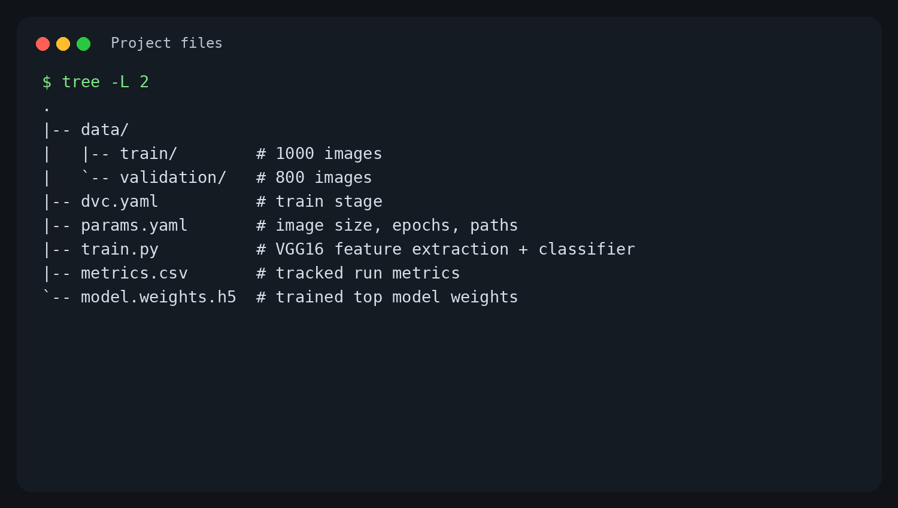
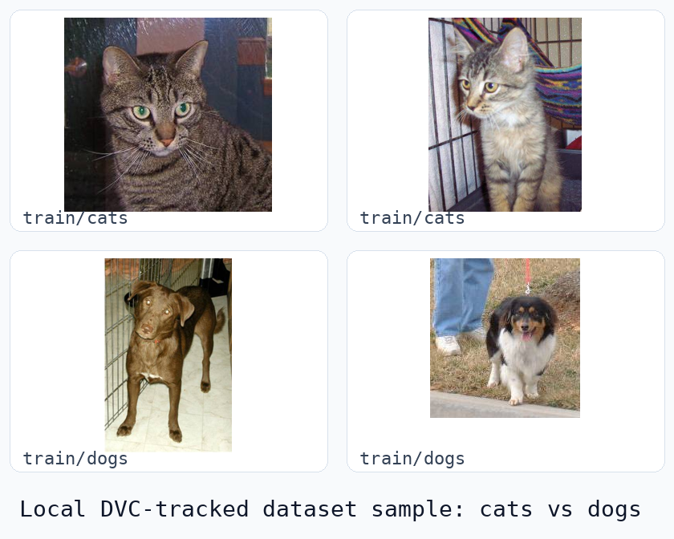
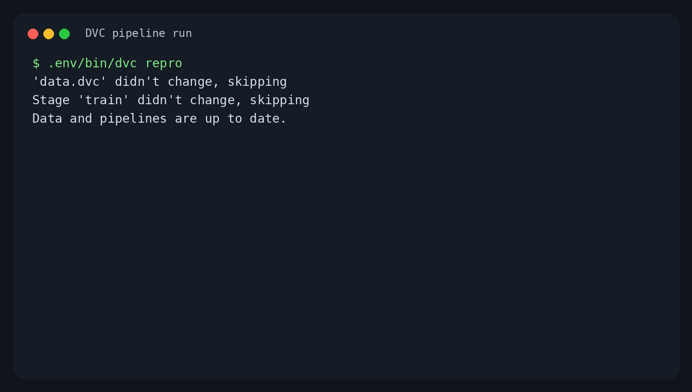
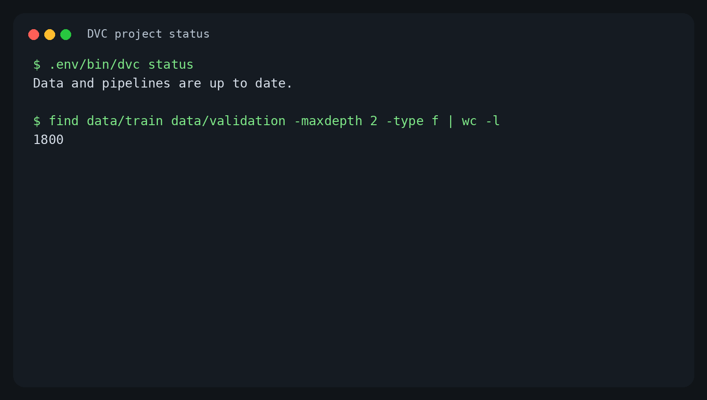
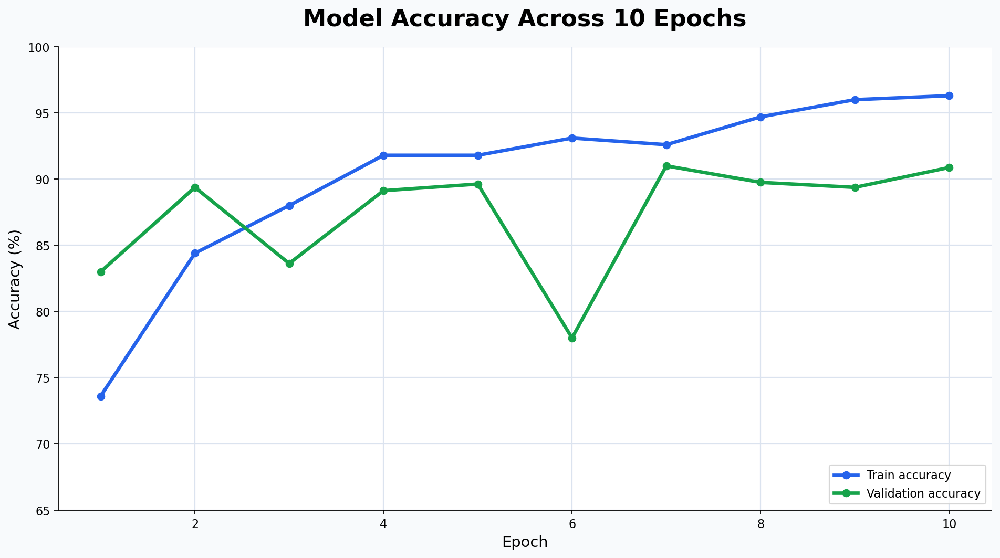

# Purpose

- Show how this repository uses DVC for ML reproducibility.
- Focus on the local cats-vs-dogs classifier project.
- Remove broad, unrelated DVC theory from the original deck.
- Keep the final deck below 20 slides.

---

# Project at a Glance

- Task: binary image classification for cats vs dogs.
- Data: 1,800 local images tracked by DVC.
- Training: VGG16 bottleneck features plus a small dense classifier.
- Reproducibility: data, parameters, metrics, and artifacts are connected through `dvc.yaml`.

---

# Repository Structure

{width=85%}

---

# DVC Role in This Project

- Git tracks code and lightweight metadata.
- DVC tracks the dataset and generated ML artifacts.
- `data.dvc` records the dataset version.
- `dvc.yaml` defines the train stage.
- `dvc.lock` captures the exact pipeline state after reproduction.

---

# Local Dataset

{width=78%}

---

# Dataset Split

- `data/train`: 1,000 images.
- `data/validation`: 800 images.
- Classes are inferred from folder names:
  - `cats`
  - `dogs`
- Total local dataset size: 1,800 image files.

---

# Training Pipeline

`dvc.yaml` defines one stage:

```yaml
train:
  cmd: python train.py --config params.yaml
  deps:
    - train.py
    - data
  outs:
    - model.weights.h5
    - bottleneck_features_train.npy
    - bottleneck_features_validation.npy
  metrics:
    - metrics.csv
```

---

# Parameters

`params.yaml` controls the training configuration:

- Image size: `150 x 150`.
- Epochs: `10`.
- Batch size: `10`.
- Training data: `data/train`.
- Validation data: `data/validation`.
- Metrics output: `metrics.csv`.

---

# Model Flow

1. Load images with Keras `ImageDataGenerator`.
2. Rescale pixels by `1 / 255`.
3. Use VGG16 without the top layer to extract bottleneck features.
4. Train a dense classifier:
   - `Flatten`
   - `Dense(256, relu)`
   - `Dropout(0.5)`
   - `Dense(1, sigmoid)`

---

# Run Evidence: Reproduce

{width=88%}

---

# Run Evidence: Status

{width=88%}

---

# Metrics

{width=88%}

---

# Latest Result

- Final training accuracy: `96.30%`.
- Final validation accuracy: `90.87%`.
- Best validation accuracy: `91.00%` at epoch 7.
- Tracked metrics file: `metrics.csv`.
- Tracked model artifact: `model.weights.h5`.

---

# Versioning Workflow

Common project commands:

```bash
dvc add data
dvc repro
git add dvc.yaml dvc.lock params.yaml metrics.csv
git commit -m "Train cats-vs-dogs model"
git tag -a v1.0 -m "model version"
```

---

# Sharing and Recovery

- Configure a DVC remote for data and artifact storage.
- Use `dvc push` to upload DVC-tracked files.
- Use `git push --follow-tags` for code, metadata, and model version labels.
- On another machine, run:

```bash
git clone <repo>
dvc pull
dvc repro
```

---

# Takeaways

- The repo is a reproducible ML training project, not just a DVC concept demo.
- DVC connects the dataset, parameters, training code, metrics, and artifacts.
- Current pipeline state is up to date after running `dvc repro`.
- The revised deck is project-specific and stays under the 20-slide limit.
